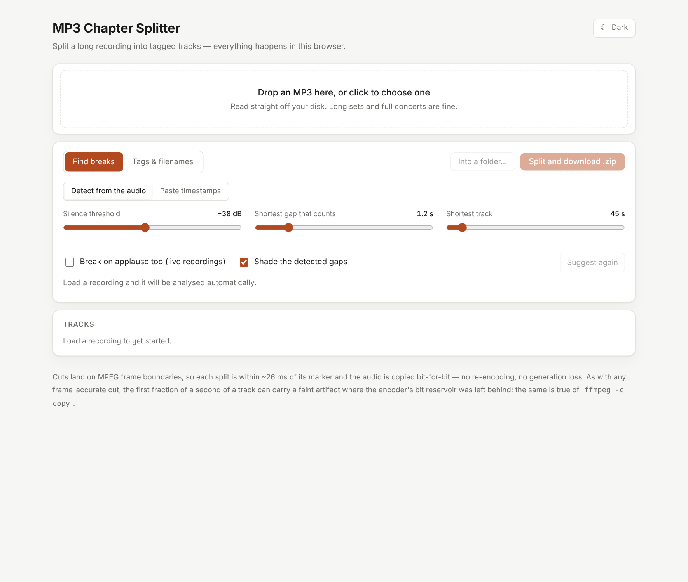
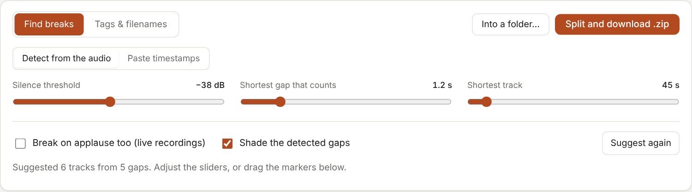
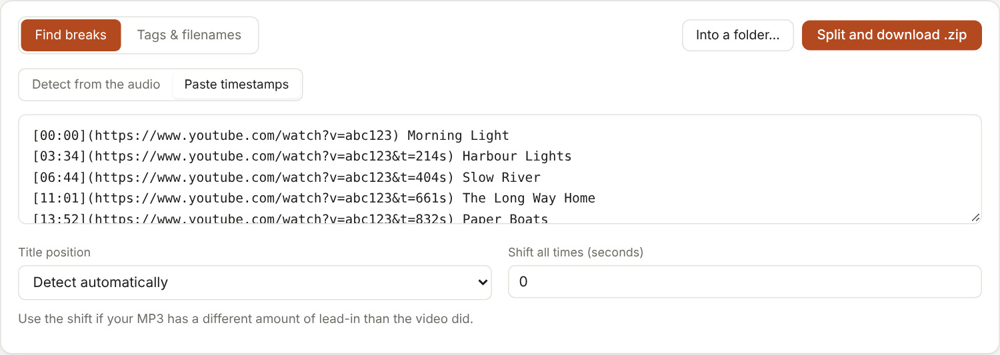
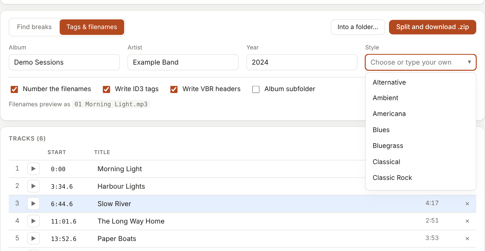
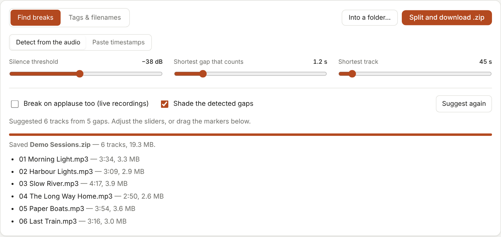

# MP3 Chapter Splitter: user manual

Split one long MP3 into separate tagged tracks, in your browser. Your audio is never uploaded.

**Contents:** [Quick start](#quick-start) · [The screen](#the-screen) · [1. Load a file](#1-load-a-file) · [2. Find the tracks](#2-find-the-tracks) · [3. Fine-tune](#3-fine-tune-on-the-waveform) · [4. Name and tag](#4-name-and-tag-the-tracks) · [5. Split](#5-split-and-save) · [Live recordings](#live-recordings) · [Keyboard](#keyboard-shortcuts) · [Troubleshooting](#troubleshooting) · [How it works](#how-it-works)

## Quick start

1. Open `mp3-chapter-splitter.html` in your browser (double-click it; no server or install needed).
2. Drop an MP3 onto the page, or click the drop area to choose one.
3. Wait for the progress bar. The app suggests where the tracks begin.
4. Check the suggestions, type the track names, and (optionally) fill in the tags.
5. Press **Split and download .zip**.



## The screen


From top to bottom:

- **The recording card**: file name, length, size, bitrate, sample rate, frame count. *choose another* loads a different file.
- **The waveform card**: transport buttons, the clock, the waveform with numbered flags, and a hint line of controls.
- **The settings card**: two tabs, *Find breaks* and *Tags & filenames*, with the **Split** buttons always within reach at the top right.
- **The track list**: one row per track with start time, title, length, and a play button.

The **Dark / Light** button (top right) switches the theme. It is one button; the choice is remembered.

## 1. Load a file

Drop an MP3 anywhere on the drop area, or click it to choose a file. Long recordings are fine: the audio is read in roughly 20-second pieces, so memory use stays flat.

While the app reads the audio to draw the waveform, a progress bar shows how far along it is:


When it finishes, breaks are suggested automatically. **Loading a new file clears everything typed for the previous one** (titles, album, artist, year, style, pasted timestamps) so a new set is never mislabelled. The album box is re-suggested from the new file's name.

## 2. Find the tracks

The **Find breaks** tab has two sub-tabs.

### Detect from the audio



The app measures loudness through the whole file and suggests a break at each quiet gap. Three sliders tune it. After moving any slider, press **Suggest again**.

| Setting | Meaning | Default |
|---|---|---|
| **Silence threshold** | How far below the music's own loudness counts as "quiet". It is *relative*, so a quiet transfer and a loud master behave alike. Move toward **-12 dB** to treat more as quiet (more breaks), toward **-60 dB** to demand near-silence. | -38 dB |
| **Shortest gap that counts** | A quiet stretch must last at least this long to be a break. Raise it to ignore short pauses inside songs. | 1.2 s |
| **Shortest track** | Never place two breaks closer together than this. Where two gaps compete, the longer one wins. Lower it for short tracks. | 45 s |

Two checkboxes:

- **Break on applause too (live recordings)**: see [Live recordings](#live-recordings).
- **Shade the detected gaps**: tints the quiet (or crowd) stretches on the waveform so you can see why a break was suggested.

The status line under the checkboxes tells you what was found ("Suggested 6 tracks from 5 gaps...").

The break is placed just before the sound returns, so each track keeps a short lead-in and the previous one keeps its fade-out. Titles you have already typed are kept when you press *Suggest again*, as long as the break has moved by less than about two seconds.

### Paste timestamps

If you already have a track list (for example from a YouTube video's description or comments), use **Paste timestamps** instead:



Paste the text into the box and the track list updates. These layouts all work, on one line or many:

```
[00:00](https://youtube.com/watch?v=...) Springtime in Vienna
0:00 Springtime in Vienna
0:00 - Springtime in Vienna
Springtime in Vienna 0:00
1:02:03  Last song of a long set
```

- **Title position**: *Detect automatically* is usually right; force *Title follows the time* or *Title comes before the time* if a list is ambiguous.
- **Shift all times (seconds)**: if your MP3 has a different amount of lead-in than the video did, enter the difference here (it can be negative).
- A time in parentheses, such as `Intro (2:15)`, is read as a duration, not a track start. A stray earlier time inside a title is ignored.
- Problems are flagged in a notice under the track list: breaks past the end of the recording, tracks shorter than 20 seconds (worth checking before you split), and tracks with no title (they will be named "Track n").

## 3. Fine-tune on the waveform

Each track starts at a numbered flag. The shaded bands alternate to show where tracks begin and end.

| To... | Do this |
|---|---|
| Listen to a track | **Tap its numbered flag.** It plays from the start of that track, and the flag shows a pause symbol while playing. |
| Listen anywhere | Click the waveform. |
| Move a break | Drag its flag or line. A short tap plays; moving the pointer a few pixels turns it into a drag. |
| Nudge a break | Select it, then press `,` (earlier) or `.` (later) for 0.1 s steps. |
| Add a break | Double-click the waveform, or put the playhead where you want it and press **+ Break** (or `M`). |
| Remove a break | Select it and press **x Remove** (or Delete / Backspace), or press the **x** at the end of its row in the track list. The track merges into the one before it. |
| Zoom | Scroll the mouse wheel over the waveform, or use the **-**, **+** and **Fit** buttons. |
| Move around when zoomed | Drag in the **overview strip** that appears below the waveform once you zoom in; its highlighted box shows the part you are viewing. |


The transport buttons sit beside **Play**: **start**, **previous break**, **next break**, **end**. Hold the pointer over any button for its shortcut.

You can also edit the track list directly: the **Start** box of each row accepts a time like `3:34.6`, the **Title** box is the track name, and the **play** button listens from that track's start. Clicking a track's number zooms the waveform to it.

## 4. Name and tag the tracks

Type the track names in the **Title** column of the track list. A track left blank is called "Track 1", "Track 2", and so on.

Open the **Tags & filenames** tab for the rest:



- **Album, Artist, Year**: written to every track. (The artist is written as both artist and album artist.)
- **Style**: click the box or the arrow for a list of common styles, or **type your own**. Whatever you type is used for the tags. To also **remember** a new style for next time, press `Enter` or choose the *Use "..."* entry at the top of the list; it then appears under **Yours**. The arrow keys and Enter work in the list.
- **Number the filenames**: `01 Morning Light.mp3` instead of `Morning Light.mp3`.
- **Write ID3 tags**: switch off for files with no tags at all.
- **Write VBR headers**: adds a header so players show the right length and seek correctly in the cut file. Leave it on unless a player misbehaves.
- **Album subfolder**: puts the tracks in a folder named after the album.

The line *Filenames preview as* shows exactly what the first file will be called. Characters not allowed in filenames (such as `/ : ? "`) are replaced with `-`.

Each track also gets its track number as `n/N` (for example `3/6`) and its length.

## 5. Split and save

Press **Split and download .zip**. The tracks are cut and a ZIP is saved to your usual Downloads location. It is named after the album (or the source file name if the album is empty).

Browsers that support folder access (Chrome and Edge) also show **Into a folder...**, which writes the files directly into a folder you choose, with no ZIP.



When it finishes, the list shows each file with its length and size.

## Live recordings

Concerts rarely go silent between songs; there is applause or crowd noise instead, and silence detection finds nothing. Tick **Break on applause too (live recordings)** and press **Suggest again**.


The app recognises a crowd by its *texture*, not its loudness: applause is broadband noise, which crosses zero far more often than music does, even when it is as loud as the band. The shaded stretches are the gaps it found.

Applause between songs is often long. If you get too few breaks, lower **Shortest track**; too many, raise **Shortest gap that counts**.

## Keyboard shortcuts

| Key | Action |
|---|---|
| `Space` | Play / pause |
| `M` | Add a break at the playhead |
| `Delete` / `Backspace` | Remove the selected break |
| `[`  `]` | Previous / next break |
| `Home`  `End` | Go to start / end |
| `<-` `->` | Skip 5 s (hold `Shift` for 1 s) |
| `,`  `.` | Nudge the selected break 0.1 s earlier / later |

Shortcuts are paused while you are typing in a text box.

## Troubleshooting

**"No MPEG audio frames found"**: the file is not an MP3 (or is damaged). Other formats must be converted to MP3 first.

**Breaks are in the wrong places.** Nudge the sliders and press *Suggest again*, or just drag the flags. For a concert, tick *Break on applause*. Or paste a timestamp list instead.

**Too many breaks / quiet passages are splitting songs.** Raise **Shortest gap that counts**, or raise **Shortest track**.

**A song's first moment has a faint click.** Cuts are lossless frame copies; the first frame can depend on audio from the frame before it (the encoder's "bit reservoir"). The same is true of `ffmpeg -c copy`. Nudge the break slightly later or earlier if you hear it.

**The waveform looks empty or the app seems stuck on very large files.** The whole file is held in memory; close other tabs, or split the file in two first.

**No "Into a folder..." button.** Your browser does not support folder access. Use the ZIP.

**The player shows the wrong length.** Make sure *Write VBR headers* is ticked on the Tags & filenames tab.

## How it works

1. **Reading.** The file is parsed frame by frame (MPEG-1/2/2.5 Layer III). Leading ID3v2 tags, trailing ID3v1 tags and any existing Xing/Info frame are skipped.
2. **Listening.** The audio is decoded by your browser in chunks of about 20 seconds, each chunk reduced to 10-millisecond records of loudness, peak and zero-crossing rate, then discarded.
3. **Suggesting.** The loud parts set a reference level; stretches far enough below it, for long enough, are gaps; the best-spaced gaps become breaks.
4. **Cutting.** Each track is the run of frames between two breaks, copied unchanged, preceded by new ID3v2.3 tags and a new Xing/Info frame.
5. **Packaging.** Tracks are written into a standard ZIP (UTF-8 filenames) or a folder.

## Privacy

Everything happens in your browser. The page makes no network requests and your audio is never uploaded. It stores two small things in your browser's local storage: your theme choice and any custom styles you add.

---

*Screenshots were produced by `capture_screenshots.js` using generated demo audio.*
