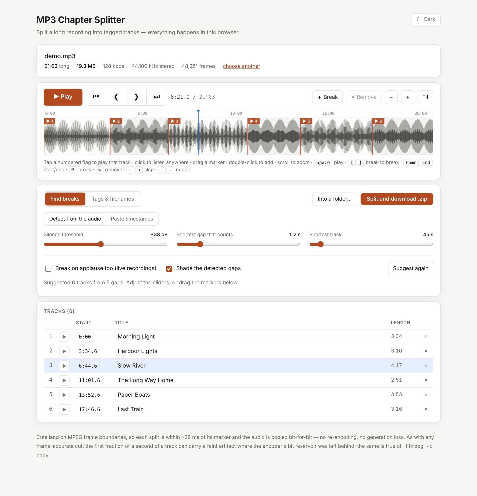
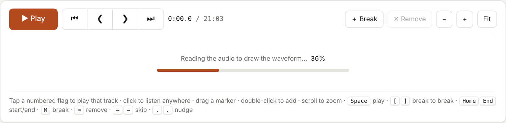
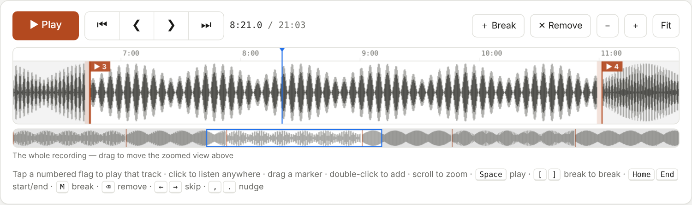
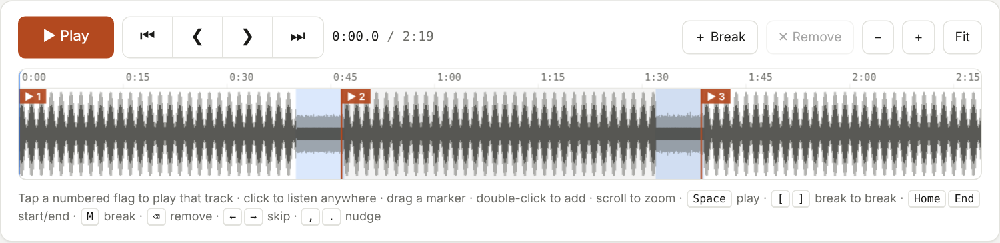
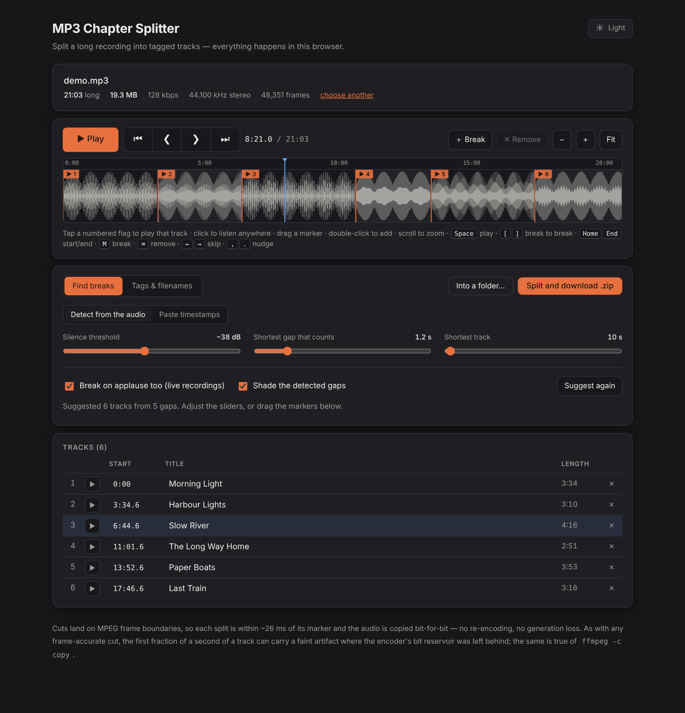

# MP3 Chapter Splitter

[Launch MP3 Chapter Splitter](https://dougalder.github.io/mp3-chapter-splitter/)

Split one long MP3 (a concert, a DJ set, an audiobook, a whole album in one file) into separate, tagged tracks, entirely in your browser. Nothing is uploaded.

A browser-based tool for splitting MP3 files into chapters, with automatic silence/break detection or manual timestamp parsing.

Find the track boundaries by **listening to the audio** (quiet gaps, or applause on live recordings) or by **pasting YouTube-style timestamps**, tidy them up on an interactive waveform, name the tracks, and download a ZIP. The audio is cut **losslessly**: frames are copied, never re-encoded.



## Use it

- **Hosted:** enable GitHub Pages for this repo (Settings -> Pages -> deploy from `main`, root). `index.html` is the landing page and links to the app.
- **Locally:** open `mp3-chapter-splitter.html` in a browser. It is one self-contained file: save it anywhere, no server, no install, works offline.

Then: choose an MP3 -> check the suggested breaks -> name the tracks -> **Split and download .zip**.
The full walkthrough, with screenshots, is in the **[manual](MANUAL.md)**.

## What it does

| | |
|---|---|
| **Detect from the audio** | Builds a loudness profile of the whole file and suggests breaks at the quiet gaps. The threshold is relative to the music level, so quiet transfers and loud masters behave alike. Live recording mode treats applause as a gap too. |
| **Paste timestamps** | Understands YouTube descriptions like `[00:00](https://...) Title`, plain `0:00 Title` lists, `Title 0:00` layouts, with a time shift for differing lead-in. |
| **Waveform editor** | Numbered flags you tap to play and drag to move; click anywhere to listen; double-click to add a break; zoom with an overview strip; start / previous break / next break / end buttons beside Play; keyboard shortcuts. |
| **Lossless cuts** | Cuts land on MPEG frame boundaries (within ~26 ms of the marker); audio bytes are copied unchanged. |
| **Tags & filenames** | ID3v2.3 title, album, artist, album artist, year, style, track n/N and length; a fresh Xing/Info header; numbered filenames; optional album subfolder. Style picker with common styles; your own are remembered. |
| **Output** | A ZIP, or straight into a folder in browsers that support it (Chrome, Edge). |
| **Long files** | Audio is analysed in ~20 s chunks so memory stays flat; a 21-minute test file is analysed in about 3 seconds here. A progress bar shows the reading. |
| **Light & dark** | One toggle button; remembered. |

| Progress while reading | Zoomed to one track | Live recording (applause shaded) |
|---|---|---|
|  |  |  |



## Privacy

Your audio never leaves your computer; the page makes no network requests. The only things stored, in your browser's `localStorage`, are the theme choice and any custom styles you type.

## Limits worth knowing

- The whole file is read into memory, so very large files need that much free RAM.
- Cuts are frame-accurate, not sample-accurate (~26 ms). As with any lossless cut (`ffmpeg -c copy` included), the first fraction of a second of a track can carry a faint artifact where the encoder's bit reservoir was left behind.
- Only MP3 input and output. Folder saving needs a browser with the File System Access API; elsewhere use the ZIP.
- Developed and tested in Chromium; the code uses standard APIs, but Safari and Firefox have not been tested.

## Develop

| File | Role |
|---|---|
| `core.js` | MP3 parsing, cutting, ID3, Xing header, timestamp parsing, ZIP. Dependency-free; works in browsers and Node. |
| `analysis.js` | Loudness envelope (Web Audio) and break detection. |
| `app.html` | Page and UI script, with markers where the two modules are inlined. |
| `build.js` | Produces **`mp3-chapter-splitter.html`** (generated: edit the sources, then run `node build.js`). |
| `index.html` | Landing page. |
| `test.js`, `analysis-test.js`, `wave-e2e.js` | Tests; `gen_fixtures.py` makes the test audio; `capture_screenshots.js` regenerates `docs/images`. |

```bash
npm install && npx playwright install chromium
sudo apt install ffmpeg unzip          # the tests use ffmpeg/ffprobe to check the output files independently
python3 gen_fixtures.py                # test audio -> fixtures/ (not committed)
node build.js                          # rebuild the single file
npm test                               # engine (27 checks) + detection (11 checks)
npm run test:browser                   # 46 checks in headless Chromium, incl. a 21-minute file
npm run screenshots                    # regenerate the manual's images
```

The engine tests cut real files and verify them with `ffprobe` (duration, tags), `ffmpeg` (clean decode) and a pitch check that each output really contains the right song. See [CONTRIBUTING.md](CONTRIBUTING.md).

## Licence

[MIT](LICENSE) (c) 2026 Doug Alder. The app contains no third-party code; formats and standards it touches, and their licensing status, are listed in [THIRD_PARTY_NOTICES.md](THIRD_PARTY_NOTICES.md). Changes: [CHANGELOG.md](CHANGELOG.md).
